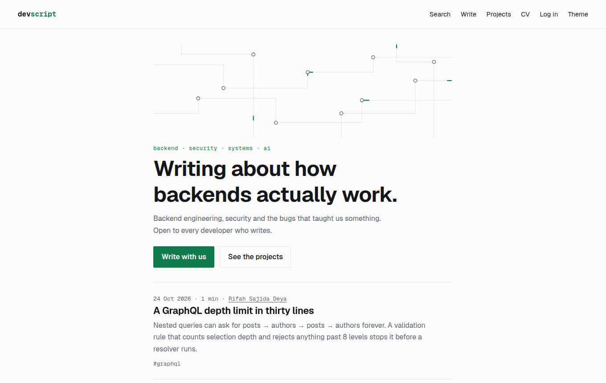
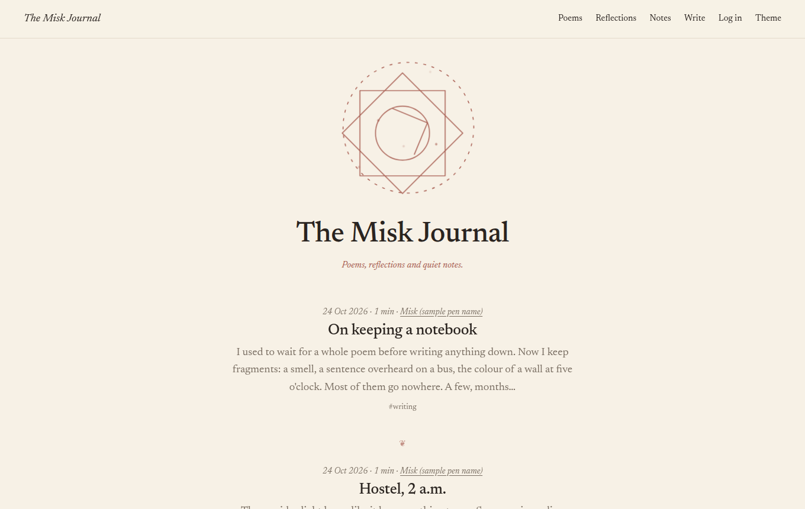
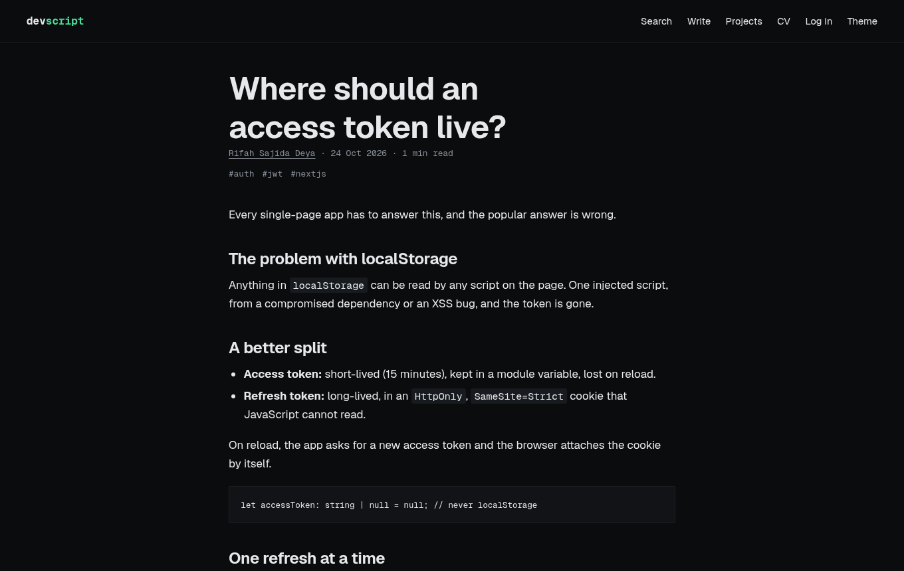
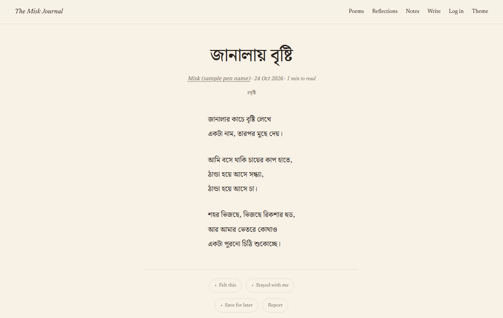
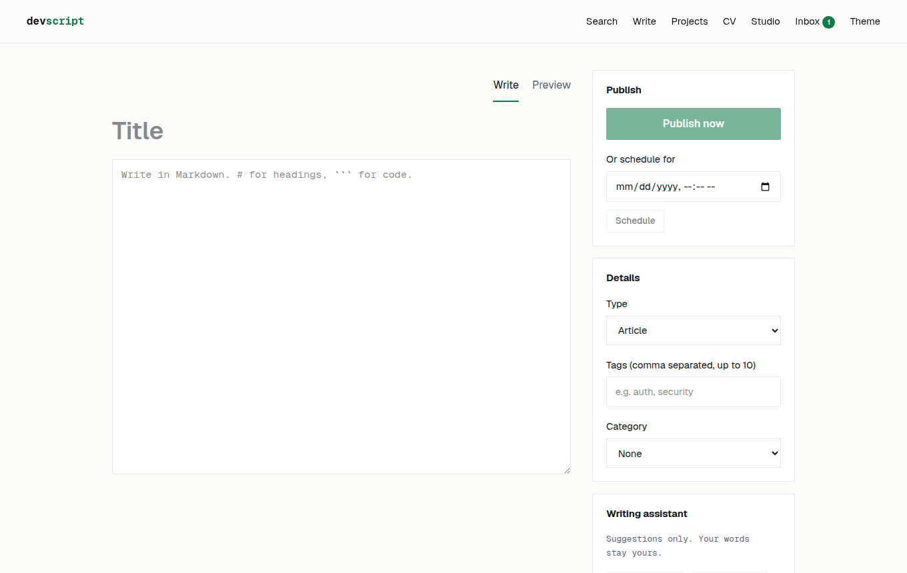
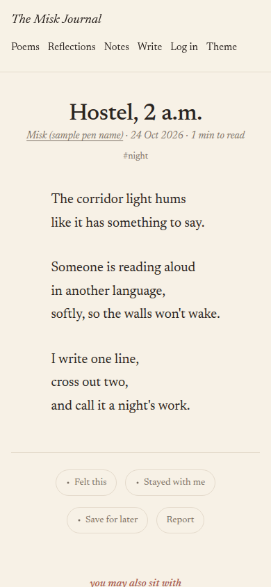
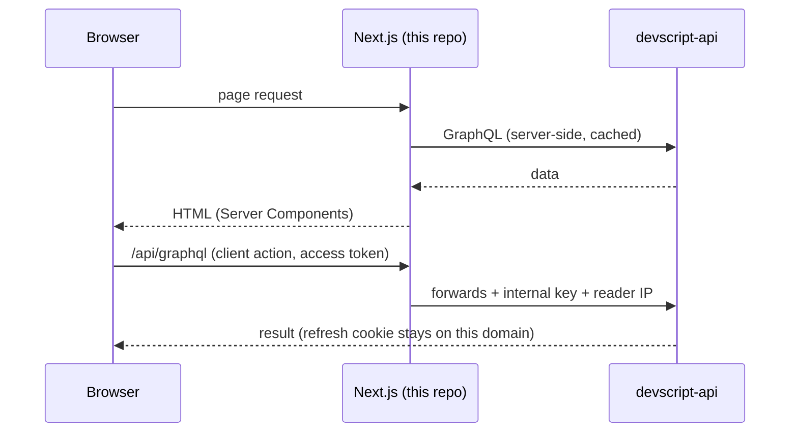

# DevScript web · The Misk Journal

**One Next.js codebase, two sites.** The same code builds:

- **DevScript**: a dark, technical magazine for developers (and the author's portfolio, projects and CV)
- **The Misk Journal**: a quiet, chapbook-like home for poems and reflections in Bangla and English

`NEXT_PUBLIC_SPACE` (`DEVSCRIPT` or `PERSONAL`) decides which one a deployment is. Everything site-specific lives in [`src/site/config.ts`](src/site/config.ts).

**Stack:** Next.js 16 (App Router, Server Components, Cache Components) · React 19 · TypeScript · plain CSS with design tokens · no UI library, no tracking
**API:** [devscript-api](https://github.com/rifah07/devscript-api) · **Deploy guide:** [devscript-api/docs/DEPLOY.md](https://github.com/rifah07/devscript-api/blob/master/docs/DEPLOY.md) (free, no card)

| DevScript | The Misk Journal |
|---|---|
|  |  |
| **An article, dark theme** | **A Bangla poem** |
|  |  |
| **Studio: the writing desk** | **On a phone** |
|  |  |

_Screenshots use sample posts and a sample pen name._

---

## Why it's interesting

- **One codebase, two identities.** A build-time switch produces two very different sites (dark technical magazine vs warm Bangla chapbook) with separate domains, sessions and SEO, and no link between them.
- **Fast by default.** Server Components and `'use cache'` make most pages static; the client bundle is small (no UI kit, no state library, no tracking).
- **Secure session handling.** Access token only in memory, HttpOnly refresh cookie through a same-origin `/api` proxy, single-flight refresh, static CSP.
- **Accessible and calm.** Semantic landmarks, visible focus, `aria-live` errors, reduced-motion support; animations are CSS/SVG only and pause off-screen.

## How a request flows



## Features

| For readers | For writers (Studio) |
|---|---|
| Fast, mostly static pages | Autosaving editor (Markdown on DevScript, stanza-safe plain text on Misk) |
| Poems rendered exactly as written | Live preview, publish or schedule |
| Search, tags, categories, series, profiles | Images with alt text, cover, reorder (shrunk in the browser before upload) |
| Reactions, bookmarks, follows, comments | AI assistant: titles, tags, editor feedback, summary, narration |
| "Ask this article" (DevScript) | Series, categories, export data, delete account |
| Newsletter, RSS, sitemap | Admin: reports, categories, users, stats |
| A plain-language writer's guide at `/write` | |

## Run locally

Start the API first (`devscript-api`, port 3000). Then:

```bash
npm install
cp .env.example .env.local      # INTERNAL_API_KEY = same value as the API's
npm run dev                     # DevScript   → http://localhost:3001
npm run dev:misk                # Misk Journal → http://localhost:3002 (can run at the same time)
```

| Command | What it does |
|---|---|
| `npm run typecheck` | Generate route types, run TypeScript |
| `npm run lint` | ESLint (React Compiler rules included) |
| `npm test` | Node's built-in test runner: single-flight refresh, open-redirect guard, stanza splitting |
| `npm run build` | Production build (needs the API running, because public pages prerender from it) |

## How it works

```
Browser ──/api/*──▶ src/app/api/[...path]/route.ts ──▶ NestJS API
                    (adds internal key + reader IP; cookies stay on this site)
Server components ──BACKEND_URL + internal key──▶ NestJS API   ('use cache' for public data)
```

| File | Responsibility |
|---|---|
| `src/site/config.ts` | The two sites: names, nav, post types, reaction labels, theme |
| `src/lib/api.ts` | Server-only GraphQL client (`server-only` keeps the key out of browsers) |
| `src/lib/queries.ts` | Cached public reads, always scoped to this site's space |
| `src/lib/session.tsx` | Access token in memory, refresh-once-and-retry on 401, `clientGql`/`clientRest` |
| `src/lib/refresh.ts` | Single-flight refresh (rotating tokens must never refresh twice at once) |
| `src/components/post/*` | Interactive islands: reactions, bookmarks, comments, ask, photo essay |
| `src/components/studio/*` | Editor, AI panel, gallery manager, series picker |
| `src/components/art/*` | The animated SVG art (pauses off-screen, respects reduced motion) |
| `src/app/globals.css` | Tokens per site and theme, then components |

## Design and performance notes

- **No layout shift, little JavaScript.** Reading pages are server-rendered; only small islands (reactions, comments) hydrate.
- **Motion is cheap by construction.** Only `transform`, `opacity` and small SVG strokes animate; an `IntersectionObserver` pauses art that's off-screen, and `prefers-reduced-motion` turns it off.
- **Poems are never reflowed.** `white-space: pre-wrap` per stanza; Bangla gets `lang="bn"`, its own font and a taller line height.
- **Security:** sanitized Markdown, no `dangerouslySetInnerHTML` except JSON-LD (escaped) and the theme script, safe `?next=` redirects, http(s)-only profile links, security headers.

## Deploy

Two Vercel projects from this one repo, differing only in `NEXT_PUBLIC_SPACE` and `NEXT_PUBLIC_SITE_URL`. Step by step: `devscript-api/docs/DEPLOY.md`.

## Status

Feature-complete for both sites. Next: deployment (two Vercel projects from this repo) and a verified email domain for reader emails.

## Author

**Rifah Sajida Deya** · [GitHub](https://github.com/rifah07)
